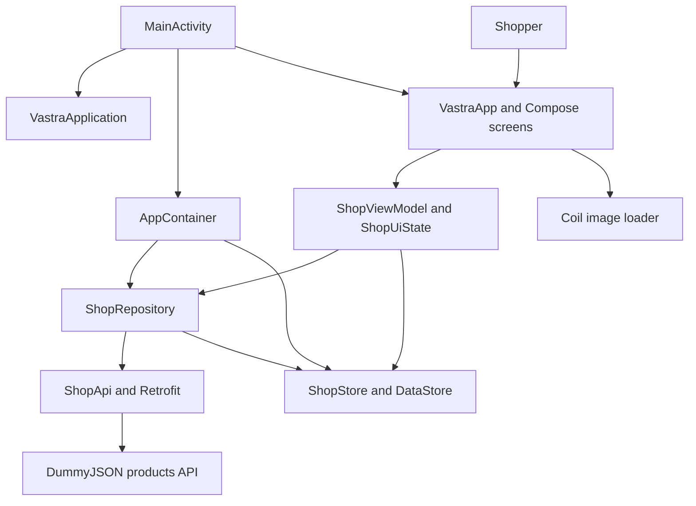
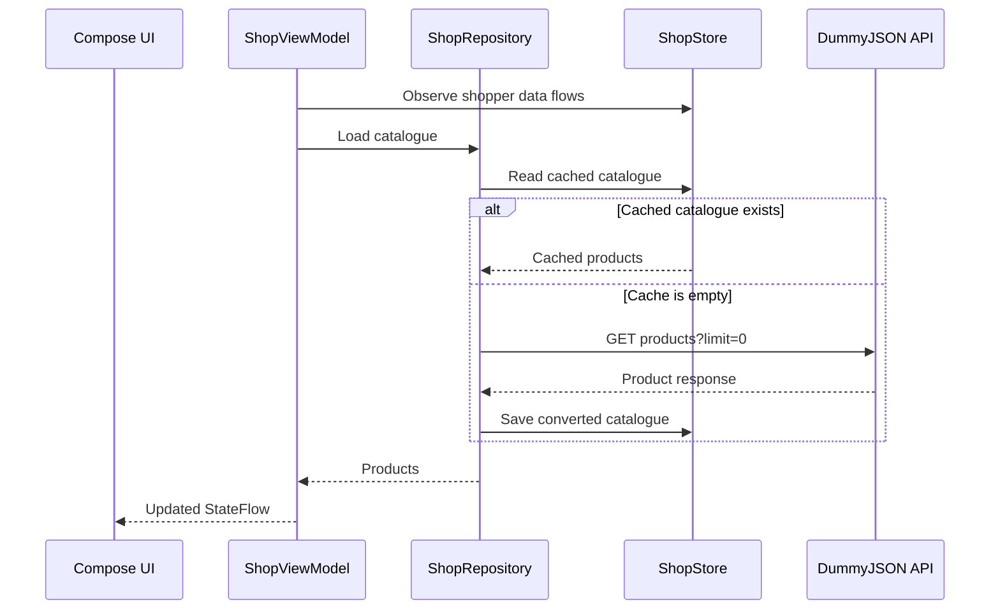

# Vastra architecture

## Overview

Vastra is a single-module Android application. Its UI is built with Jetpack Compose, app state is held by `ShopViewModel`, catalogue access is mediated by `ShopRepository`, and local shopper data is stored by `ShopStore`.

## Startup and dependency wiring

1. Android creates `VastraApplication`, which constructs one `AppContainer`.
2. `AppContainer` creates `ShopStore` and `ShopRepository`, passing the repository the Retrofit API and store.
3. `MainActivity` reads the container and creates a `ShopViewModelFactory`.
4. The activity installs `VastraApp` inside `VastraTheme`; Compose obtains the ViewModel through the factory.
5. `ShopViewModel` begins observing persisted flows and loading the catalogue.

Dependencies are wired manually; the project does not use a dependency-injection framework.

## UI and state

`VastraApp` owns the navigation host and observes `ShopViewModel.state` with lifecycle-aware collection. It passes immutable state and event callbacks to the screens. The ViewModel exposes `StateFlow<ShopUiState>` and handles catalogue filtering/sorting, bag and wishlist operations, checkout validation, and local data updates.

Navigation routes are declared in `ui/VastraApp.kt`. The catalogue, wishlist, bag, orders, and profile are bottom-navigation destinations. Product details use a product ID route, and checkout is reached from the bag.

Screens are presentation components: user actions flow back through callbacks to the ViewModel. Shared display components live under `ui/components/`, and Material theme definitions live under `ui/theme/`.

## Catalogue and persistence flow

`ShopRepository.products()` uses this order when no forced refresh is requested:

1. Return its in-memory catalogue if available.
2. Read the persisted catalogue cache from `ShopStore`.
3. If there is no local catalogue, request all products from `ShopApi`.
4. Convert incoming prices using the configured USD-to-INR multiplier, filter to the supported fashion categories when matches exist, cache the result in memory and DataStore, and return it.

On a network failure, the repository tries the persisted catalogue cache; if there is no cached catalogue, it propagates the error for the ViewModel to display. A forced refresh skips the initial memory and disk reads but still falls back to the disk cache on failure.

`ShopStore` stores the catalogue cache, bag, wishlist, profile, delivery address, and orders in DataStore Preferences. Values are JSON-serialized with Gson. DataStore flows are observed by the ViewModel, which updates `ShopUiState` as persisted values change.

Bag, wishlist, profile, address, and order writes are local. Checkout validates and normalizes address fields, checks the bag, creates a local order, saves the order/address, and clears the bag. No remote order or payment request is made.

## Network and images

`Network` configures a lazy Retrofit client with Gson conversion, 20-second timeouts, connection retry, and HTTP logging at BASIC level in debug builds and NONE in release builds. `ShopApi` currently exposes only the DummyJSON product catalogue endpoint.

Coil is configured by `VastraApplication` with crossfade, a memory cache capped at 25% of the available app memory, and a disk cache under the app cache directory. Product image URLs are loaded by the UI.

## Business rules

Pricing and address helpers are in `util/Pricing.kt`. They define the currency conversion constant, shipping threshold and fee, quantity limit, category labels, size options, price formatting, and delivery-address validation. Product-derived values such as discounted price and stock status are in `data/model/Models.kt`.

## Build, security, and tests

The Android application is the `:app` Gradle module. Java and Kotlin bytecode target version 17; the module compiles against SDK 34 and supports API 26 and later. Release builds enable minification and resource shrinking.

The manifest disables cleartext network traffic. DataStore values remain app-local; backup exclusions and device-transfer rules are defined in `app/src/main/res/xml/`. These settings do not make the local data an encrypted account store.

Unit tests are under `app/src/test/java/com/vastra/store/`. They cover pricing/address helpers and product/cart model calculations. The project currently has no instrumentation or end-to-end test suite.
